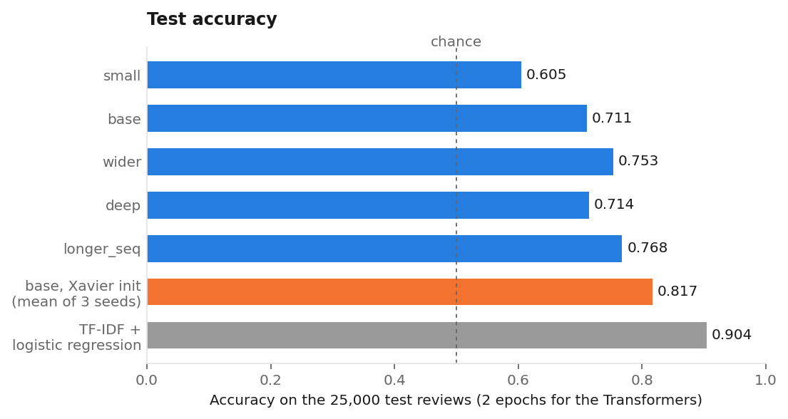
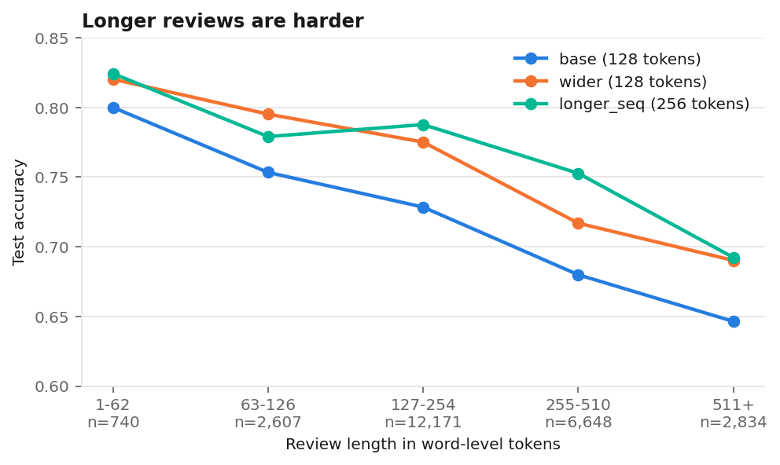
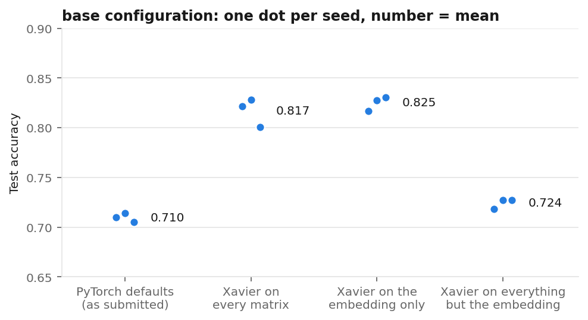

# Transformer encoder for IMDb sentiment

My final project for a Neural Networks course during my exchange semester in Kraków: an encoder-only Transformer written in PyTorch, trained with no pretrained weights to tell positive from negative IMDb reviews, in five different sizes.

I later went back to it to answer what my report had left open: how it does on the official test set, how it compares with a simple baseline, and why the numbers were so low. A large part of the answer to the last one is [how the embedding layer is initialised](#the-initialisation).

## Results

Test accuracy on the 25,000 official test reviews, after 2 epochs.

| model | context (tokens) | parameters | validation | test | test reviews truncated |
|---|---:|---:|---:|---:|---:|
| small | 64 | 1.97 M | 0.612 | 0.605 | 97% |
| base | 128 | 4.24 M | 0.712 | 0.711 | 87% |
| wider | 128 | 9.26 M | 0.744 | 0.753 | 87% |
| deep | 128 | 4.63 M | 0.707 | 0.714 | 87% |
| longer_seq | 256 | 4.24 M | 0.759 | 0.768 | 38% |
| TF-IDF + logistic regression | full review | | 0.912 | 0.904 | 0% |



- **The baseline wins by a wide margin.** Unigram and bigram TF-IDF with logistic regression, trained on the same 22,500 reviews, fits in seconds and reaches 0.904. None of the Transformers trained here gets there.
- **Within the original five, more context and more width helped; more depth did not** (in two epochs).
- **Read the `longer_seq` result with care.** It uses batch size 16 instead of 32, so it takes twice as many optimiser steps. It also beats `base` on reviews of 62 tokens or fewer, which neither model truncates, so the longer window is not the whole explanation.



Every model does worse on longer reviews, and for those with 128 tokens or more the drop starts among reviews that still fit in the window. All five are in [`results/test_accuracy_by_length.csv`](results/test_accuracy_by_length.csv).

## The initialisation

My training code kept PyTorch's default initialisation. The implementation I built on applies Xavier-uniform to every weight matrix, a step I had not carried over. I retrained `base` with and without it, three seeds each:

| initialisation | validation (mean of 3) | test (mean of 3) | test range |
|---|---:|---:|---:|
| PyTorch defaults, as in my project | 0.701 | 0.710 | 0.705 to 0.714 |
| Xavier on every matrix | 0.834 | 0.817 | 0.800 to 0.828 |
| Xavier on the token embedding only | 0.847 | 0.825 | 0.817 to 0.830 |
| Xavier on everything except the embedding | 0.721 | 0.724 | 0.718 to 0.727 |



The token embedding is what matters. Re-initialising it alone adds about 11 points of test accuracy over the defaults, as much as re-initialising the whole model, while re-initialising everything else adds about 1.

My reading is that this is a matter of scale. `nn.Embedding` starts with weights of standard deviation 1, against about 0.008 for Xavier on a 30,000 by 128 table. Adam at a learning rate of 1e-4 moves a weight by roughly 1e-4 per step at most, and two epochs are about 1,400 steps. That is small next to starting values of size 1, so what the model learns about each word stays mixed with random noise. I have not tested this explanation beyond the comparison above. Even with the better start, the model stays below the TF-IDF baseline.

The default in `train_imdb.py` is still the original one, so the first table can be regenerated. Use `--init xavier_embedding` for the better setting.

## Model

```
token ids -> embedding * sqrt(d_model) + sinusoidal positions
          -> N x [ pre-norm self-attention, pre-norm feed-forward ]
          -> final layer norm -> mean over non-padding positions -> linear (2 classes)
```

| model | d_model | layers | heads | d_ff | seq_len | batch |
|---|---:|---:|---:|---:|---:|---:|
| small | 64 | 1 | 2 | 256 | 64 | 32 |
| base | 128 | 2 | 4 | 512 | 128 | 32 |
| wider | 256 | 2 | 8 | 1024 | 128 | 32 |
| deep | 128 | 4 | 4 | 512 | 128 | 32 |
| longer_seq | 128 | 2 | 4 | 512 | 256 | 16 |

All use dropout 0.1, Adam with learning rate 1e-4 and cross-entropy. The context length includes the start and end markers.

## Data

[IMDb](https://huggingface.co/datasets/imdb), downloaded through Hugging Face `datasets`. The 25,000 training reviews are split 90/10 into train and validation with a fixed seed. The tokenizer is word level, splits on whitespace and punctuation, keeps case, and has a vocabulary of 30,000, so the embedding table holds most of the parameters (3.84 M of `base`'s 4.24 M).

## Run it

Python 3.11. Everything here ran on a CPU.

```bash
pip install -r requirements.txt
python train_imdb.py                                  # five models, written to runs/
python evaluate.py --checkpoints runs/checkpoints     # validation and test tables
python baseline.py                                    # TF-IDF reference
python ablation.py                                    # initialisation study (12 trainings, reuses finished ones)
python make_figures.py
pytest
```

`python train_imdb.py --experiments base --init xavier --seed 0` trains a single model.

About reproducibility:

- Model weights are not in the repository. The test table was computed from the checkpoints of my original runs, which reproduce the validation accuracies in the report exactly.
- Those runs set no seed for weights or shuffling, so retraining gives slightly different numbers. For `base`, three seeded reruns with the original setup landed between 0.689 and 0.712 on validation (originally 0.712).

## What else to keep in mind

- Two epochs is short. These numbers compare configurations under a small budget, not the best each one can do.
- Apart from the initialisation study, each configuration was trained once.
- The tokenizer is fitted on all 25,000 training reviews, including the 2,500 used for validation. The test set is never used for fitting, and the baseline fits its vocabulary on the 22,500 only.

## Layout

```
model.py          the network
train_imdb.py     data pipeline, training loop, the five configurations
evaluate.py       validation and test accuracy, by review length
baseline.py       TF-IDF + logistic regression
ablation.py       initialisation study
plots.py          training curve plots from the original project
make_figures.py   figures in this README
results/          CSV outputs; results/original/ holds the logs of the first runs
report/           my original report (validation results only)
```

## Authorship and credit

I did this project on my own.

The building blocks in [`model.py`](model.py) (layer normalisation, feed-forward block, embeddings, positional encoding, residual connection, multi-head attention and the encoder stack) follow [Umar Jamil's `pytorch-transformer`](https://github.com/hkproj/pytorch-transformer) almost line by line. The tokenizer builder and the shape of the dataset class are modelled on the same repository. That repository declares no license, and those parts remain its author's work.

Mine are the encoder-only classifier at the end of `model.py`, the IMDb pipeline and training loop, the choice of configurations, the experiments and the report. The test evaluation, baseline, initialisation study, command line options and tests came after the course.
